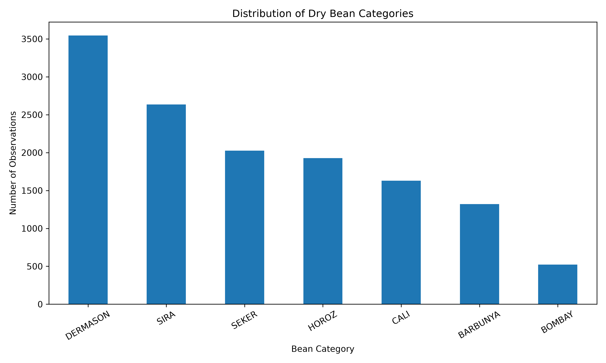
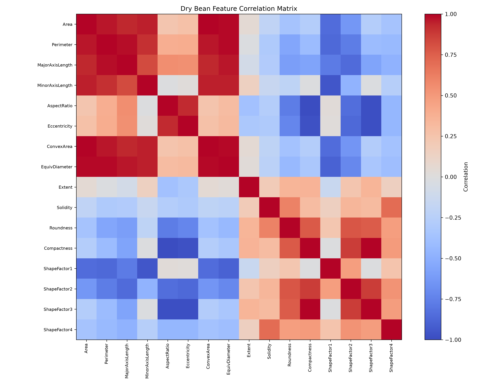
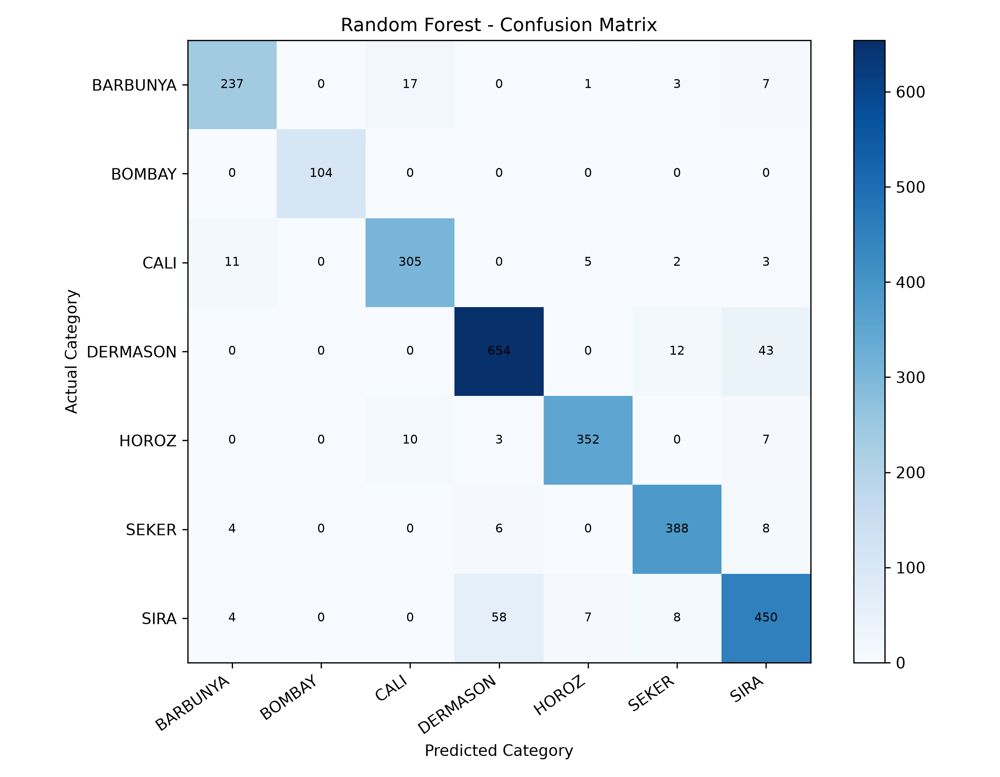
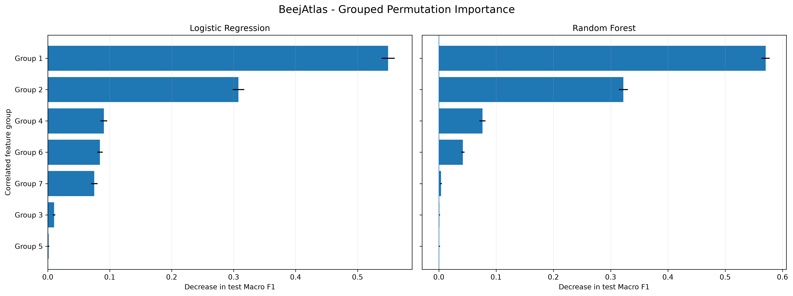

# BeejAtlas

**Exploring seed diversity through data, databases and machine learning**

BeejAtlas is an independent student research project inspired by seed conservation, agricultural biodiversity and community-led knowledge preservation. Its long-term vision is to make responsibly reusable information about seed diversity easier to explore through data science, data engineering and visualisation.

> **Important scope note:** The machine-learning experiment currently implemented in this repository uses the UCI Dry Bean benchmark. It classifies seven registered dry-bean categories using pre-computed numerical measurements. It does not identify Indian traditional seed varieties, assess climate resilience or measure the diversity of India's community seed banks. The Indian seed-conservation explorer is a planned component and is not yet implemented with CSE data.

---

## Project Status

### Implemented

- Downloaded the UCI Dry Bean dataset using `ucimlrepo`.
- Explored class frequencies, descriptive statistics, missing values, duplicates and feature correlations.
- Removed 68 exact duplicate records, retaining 13,543 unique observations.
- Compared physical measurements across seven categories.
- Trained and evaluated Dummy Classifier, Logistic Regression and Random Forest models.
- Used a stratified 80:20 train-test split.
- Conducted five-fold stratified cross-validation on the training partition.
- Conducted repeated stratified five-fold cross-validation with three repetitions (15 fold scores per model).
- Examined confusion matrices, individual permutation importance and grouped permutation importance.
- Developed an interactive Streamlit dashboard using Plotly.
- Prepared a research report documenting methodology, experimental findings and limitations.

### Planned

- Integrate appropriately licensed Indian seed-conservation information, subject to written permission.
- Conduct independent external validation of the classification experiment.
- Add automated tests and strengthen reproducibility.
- Deploy the Streamlit application publicly.
- Explore structured database integration using SQLite.

---

## Why This Project?

BeejAtlas is inspired by seed-saving and biodiversity-conservation work, including the broader public discussion around traditional seeds and community seed banks.

The aim is to use data tools responsibly while keeping community knowledge, data permissions and research limitations visible.

The current UCI experiment is a separate technical benchmark used to practise and demonstrate a complete tabular machine-learning workflow. It should not be interpreted as evidence about the seed varieties documented by Indian community seed banks.

---

## Dataset Currently Used

### UCI Dry Bean Dataset

The UCI Dry Bean dataset contains 13,611 observations of seven registered dry-bean types. Each observation has 16 numerical features derived from high-resolution bean images.

The features include:

- Area
- Perimeter
- Major Axis Length
- Minor Axis Length
- Aspect Ratio
- Eccentricity
- Convex Area
- Equivalent Diameter
- Extent
- Solidity
- Roundness
- Compactness
- ShapeFactor1
- ShapeFactor2
- ShapeFactor3
- ShapeFactor4

**Dataset information:**

- **Source:** [UCI Machine Learning Repository — Dry Bean](https://archive.ics.uci.edu/dataset/602/dry+bean)
- **DOI:** [10.24432/C50S4B](https://doi.org/10.24432/C50S4B)
- **Licence:** CC BY 4.0, subject to attribution.
- **Original dataset size:** 13,611 observations.
- **Numerical features:** 16.
- **Target classes:** 7.

The target categories are:

1. BARBUNYA
2. BOMBAY
3. CALI
4. DERMASON
5. HOROZ
6. SEKER
7. SIRA

After exact duplicate removal, 68 duplicate records were removed, leaving 13,543 unique observations.

The original raw file is retained locally, while the cleaned dataset is stored separately.

### Indian Community Seed-Bank Data — Planned, Permission Pending

The Centre for Science and Environment (CSE) publishes an interactive Community Seed Banks resource.

BeejAtlas's author has contacted CSE to request written permission for analysis, transformation and public display of data or derived outputs.

Until permission and applicable conditions are confirmed, CSE's underlying dataset must not be copied into this repository, redistributed or used to power a public BeejAtlas deployment.

- **Public resource:** [CSE Community Seed Banks](https://www.cseindia.org/page/seedbank)
- **CSE terms:** [Terms and Conditions](https://www.cseindia.org/terms-1234)

The CSE resource describes a snapshot of information collected from NGOs, community seed banks and individual seed savers. Its coverage should not be presented as a complete census of Indian seed diversity.

---

## Repository Structure

```text
BeejAtlas/
│
├── README.md
├── .gitignore
├── requirements.txt
│
├── app/
│   └── streamlit_app.py
│
├── data/
│   ├── raw/                 # Local, Git-ignored data
│   ├── processed/           # Local, Git-ignored data
│   └── metadata/
│
├── docs/
│   └── RESEARCH_REPORT.md
│
├── notebooks/
│
├── src/
│   ├── database/
│   │
│   ├── ingestion/
│   │   └── download_dry_bean.py
│   │
│   ├── processing/
│   │   ├── explore_dry_bean.py
│   │   └── analyze_class_features.py
│   │
│   └── ml/
│       ├── train_models.py
│       ├── permutation_importance.py
│       ├── grouped_permutation_importance.py
│       └── repeated_cross_validation.py
│
├── tests/
│
├── models/                  # Locally saved models, Git-ignored
│
└── outputs/
    ├── figures/
    └── tables/
```

Generated data and locally fitted models are excluded from Git using `.gitignore`. Research figures and aggregate result tables are included where appropriate.

Do not commit CSE source data unless written permission explicitly allows it.

---

## Technology Stack

| Technology | Purpose |
|---|---|
| Python | Core programming language |
| pandas | Data manipulation |
| NumPy | Numerical computation |
| Matplotlib | Statistical visualisation |
| scikit-learn | Machine learning |
| ucimlrepo | Dataset retrieval |
| joblib | Model utilities |
| Streamlit | Interactive dashboard |
| Plotly | Interactive charts |
| SQLite | Planned structured data storage |

---

## Setup and Reproducibility

### Requirements

- Python
- pip
- Git
- Internet connection for dataset retrieval

### 1. Clone the repository

```cmd
git clone https://github.com/shrushti200/BeejAtlas.git
```

Navigate into the project:

```cmd
cd BeejAtlas
```

### 2. Install dependencies

```cmd
py -m pip install -r requirements.txt
```

### 3. Download the UCI Dry Bean dataset

```cmd
py src\ingestion\download_dry_bean.py
```

### 4. Explore the raw dataset

```cmd
py src\processing\explore_dry_bean.py
```

### 5. Remove exact duplicate records

The cleaning operation retains the first copy of each exact row and creates a separate processed file without overwriting the original dataset.

```cmd
py -c "import pandas as pd; from pathlib import Path; d=pd.read_csv('data/raw/dry_bean.csv'); before=len(d); d=d.drop_duplicates(keep='first').reset_index(drop=True); out=Path('data/processed/dry_bean_clean.csv'); out.parent.mkdir(parents=True,exist_ok=True); d.to_csv(out,index=False); print('Original:',before,'Removed:',before-len(d),'Cleaned:',len(d))"
```

For the recorded experiment, 68 duplicate rows were removed, leaving 13,543 observations.

### 6. Compare features by class

```cmd
py src\processing\analyze_class_features.py
```

### 7. Train and evaluate baseline models

```cmd
py src\ml\train_models.py
```

### 8. Calculate individual permutation importance

```cmd
py src\ml\permutation_importance.py
```

### 9. Calculate grouped permutation importance

```cmd
py src\ml\grouped_permutation_importance.py
```

### 10. Run repeated stratified cross-validation

```cmd
py src\ml\repeated_cross_validation.py
```

### 11. Launch the interactive dashboard

```cmd
py -m streamlit run app\streamlit_app.py
```

The scripts generate analytical tables under `outputs/tables/`, figures under `outputs/figures/` and locally fitted models under `models/`.

---

## Interactive Dashboard

BeejAtlas includes a Streamlit application with six navigation sections:

1. **Project Overview** — Project introduction and dataset summary.
2. **Seed Data Explorer** — Interactive exploration of dry-bean categories and numerical features.
3. **Machine Learning Lab** — Model comparison, cross-validation results, classification reports and confusion matrices.
4. **Feature Importance** — Individual and grouped permutation importance.
5. **Research & Limitations** — Research methodology, dataset attribution and experimental limitations.
6. **Indian Seed Conservation** — Planned research component, subject to appropriate data permissions.

The dashboard currently explores the UCI Dry Bean benchmark and does not provide an Indian traditional-seed identification system.

---

## Selected Research Visualisations

The following figures summarise exploratory analysis and model interpretation.

### 1. Dry-Bean Category Distribution



### 2. Feature Correlation Heatmap



### 3. Random Forest Confusion Matrix



### 4. Grouped Permutation Importance



---

## Machine-Learning Methodology

### Data Preparation

- Target column: `Class`.
- Predictors: All 16 numerical feature columns.
- Exact duplicate rows removed: 68.
- Training-test split: 80:20.
- Stratification: By class.
- Random state: 42.
- Training observations: 10,834.
- Test observations: 2,709.

### Models

**1. Dummy Classifier**

- Strategy: `most_frequent`.
- Used as a reference baseline.

**2. Logistic Regression**

- StandardScaler.
- Maximum iterations: 3,000.
- Class weighting: `balanced`.
- Random state: 42.
- Implemented using a scikit-learn Pipeline.

**3. Random Forest**

- Number of trees: 200.
- Class weighting: `balanced_subsample`.
- Random state: 42.
- `n_jobs=1`.

### Original Model Evaluation

Five-fold `StratifiedKFold` cross-validation with shuffling and random state 42 was conducted on the training partition.

Each model was subsequently fitted on the complete training partition and evaluated on the held-out test partition.

The following are results from the recorded experimental run.

| Model | Test Accuracy | Test Balanced Accuracy | Test Macro F1 |
|---|---:|---:|---:|
| Dummy Classifier | 26.17% | 14.29% | 5.93% |
| Logistic Regression | 91.55% | 93.00% | 92.79% |
| Random Forest | 91.92% | 92.97% | 93.08% |

Random Forest had a small lead in test accuracy and Macro F1, while Logistic Regression achieved marginally higher test balanced accuracy.

These differences do not establish statistical superiority.

### Repeated Stratified 5-Fold Cross-Validation

A separate experiment evaluated all 13,543 cleaned observations using `RepeatedStratifiedKFold`.

Experimental configuration:

- Number of folds: 5.
- Number of repetitions: 3.
- Total fold-level scores per model: 15.
- Random state: 42.
- Evaluation metrics: Accuracy, Macro F1 and Balanced Accuracy.
- Identical cross-validation partitions were used for all three models.

Results are reported as mean and standard deviation across 15 fold scores.

| Model | Accuracy Mean ± SD | Macro F1 Mean ± SD | Balanced Accuracy Mean ± SD |
|---|---:|---:|---:|
| Dummy Classifier | 26.18% ± 0.01 pp | 5.93% ± 0.00 pp | 14.29% ± 0.00 pp |
| Logistic Regression | 91.89% ± 0.58 pp | 93.24% ± 0.48 pp | 93.36% ± 0.45 pp |
| Random Forest | 92.31% ± 0.44 pp | 93.45% ± 0.39 pp | 93.28% ± 0.39 pp |

*pp represents percentage points.*

Random Forest achieved the highest mean accuracy and Macro F1. Logistic Regression achieved slightly higher mean balanced accuracy.

The differences were small and do not establish statistical superiority.

The standard deviations describe fold-to-fold variation, not confidence intervals. The 15 fold scores are dependent because observations are reused across repetitions. This experiment provides internal validation, not independent external validation.

### Random Forest Class-Level Test Results

| Class | Precision | Recall | F1-score | Test Support |
|---|---:|---:|---:|---:|
| BARBUNYA | 92.58% | 89.43% | 90.98% | 265 |
| BOMBAY | 100.00% | 100.00% | 100.00% | 104 |
| CALI | 91.87% | 93.56% | 92.71% | 326 |
| DERMASON | 90.71% | 92.24% | 91.47% | 709 |
| HOROZ | 96.44% | 94.62% | 95.52% | 372 |
| SEKER | 93.95% | 95.57% | 94.75% | 406 |
| SIRA | 86.87% | 85.39% | 86.12% | 527 |

SIRA had the lowest Random Forest recall in the original held-out test split.

BOMBAY achieved perfect test metrics on 104 observations. This should not be interpreted as a guarantee of perfect performance on unseen data.

### Confusion-Matrix Observations

The largest reciprocal confusion between two categories was observed between DERMASON and SIRA.

- Logistic Regression: 71 DERMASON observations were predicted as SIRA, while 30 SIRA observations were predicted as DERMASON.
- Random Forest: 43 DERMASON observations were predicted as SIRA, while 58 SIRA observations were predicted as DERMASON.

Both models showed different directional errors, although their combined errors for this pair were equal in the original test split.

### Feature Importance

Random Forest's impurity-based feature importance ranked Perimeter, ShapeFactor1, Compactness, MinorAxisLength and ShapeFactor3 among the top five features in the recorded experiment.

Impurity-based importance can distribute importance across correlated predictors and should not be interpreted as causal influence.

Individual permutation importance was calculated on the held-out test set using 20 repeats and Macro F1 as the scoring metric.

Grouped permutation importance used 30 repeats.

Feature groups were formed using absolute Pearson correlations of at least 0.90, calculated on the training partition using connected components.

| Correlated Group | Features | Logistic Regression Importance | Random Forest Importance |
|---|---|---:|---:|
| Group 1 | Area, Perimeter, MajorAxisLength, MinorAxisLength, ConvexArea, EquivDiameter, ShapeFactor1 | 0.5494 ± 0.0106 | 0.5706 ± 0.0072 |
| Group 2 | AspectRatio, Eccentricity, Compactness, ShapeFactor3 | 0.3078 ± 0.0093 | 0.3222 ± 0.0078 |
| Group 3 | Extent | 0.0014 ± 0.0011 | 0.0009 ± 0.0012 |
| Group 4 | Roundness | 0.0750 ± 0.0052 | 0.0763 ± 0.0053 |
| Group 5 | ShapeFactor2 | 0.0906 ± 0.0053 | 0.0008 ± 0.0012 |
| Group 6 | ShapeFactor4 | 0.0842 ± 0.0044 | 0.0420 ± 0.0028 |
| Group 7 | Solidity | 0.0101 ± 0.0019 | 0.0038 ± 0.0014 |

Grouped importance is the mean decrease in test Macro F1 after jointly permuting all columns in a group.

These values are not percentages and do not sum to 100%.

Joint permutation preserves relationships within the permuted group but breaks its relationships with the other predictors. This can create combinations that may not occur naturally.

The results should be treated as exploratory evidence of model reliance, not causal feature effects.

---

## Limitations

- The UCI benchmark describes seven registered dry-bean categories; it is not a representative dataset of India's traditional seed varieties or community seed banks.
- The current experiment uses pre-extracted numerical measurements, not raw seed images. It is not an image-recognition application.
- Class frequencies are uneven. The BOMBAY class has 522 observations in the cleaned dataset, compared with 3,546 DERMASON observations.
- The original held-out test set was reused for model comparison and permutation-based interpretation. Consequently, test metrics should be treated as exploratory, not as a final independent estimate.
- Repeated cross-validation provides internal validation rather than independent external validation.
- Its 15 fold-level scores are dependent because observations are reused across repetitions.
- Standard deviations across these scores are descriptive measures, not confidence intervals.
- Grouped permutation may create unrealistic combinations between the permuted group and the remaining predictors.
- The project has not demonstrated field performance, seed viability, climate resilience, farmer outcomes or conservation impact.
- CSE community seed-bank data is not included. Public use is pending written permission and any conditions CSE specifies.

---

## Responsible Data Use

BeejAtlas is an educational, non-commercial student research project.

It distinguishes public benchmark data from community-held knowledge.

Personal, sensitive or community-restricted information should not be published without an appropriate lawful basis and explicit permission.

Any future CSE integration must follow CSE's written permission and attribution requirements.

---

## References

1. M. Koklu and I. A. Özkan (2020). **Dry Bean** [Dataset]. UCI Machine Learning Repository. https://doi.org/10.24432/C50S4B
2. [UCI Dry Bean Dataset](https://archive.ics.uci.edu/dataset/602/dry+bean)
3. Centre for Science and Environment. **Community Seed Banks**. https://www.cseindia.org/page/seedbank
4. Centre for Science and Environment. **Terms and Conditions**. https://www.cseindia.org/terms-1234

---

## Author

**Shrushti Bhoyar**  
B.Sc. Data Science Student  
Savitribai Phule Pune University, India.

---

*BeejAtlas is an independent student project. It is not affiliated with, endorsed by, or an official product of UCI, CSE, Navdanya or Vandana Shiva.*
